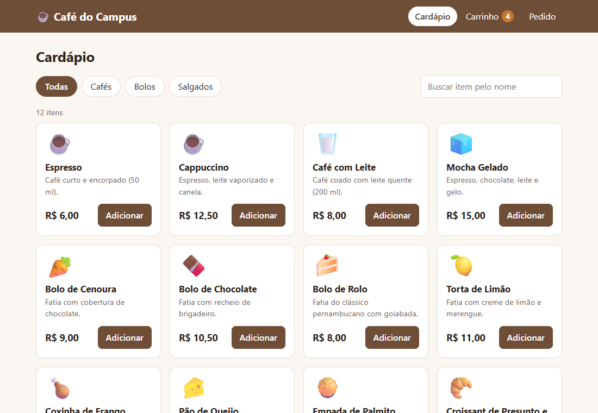
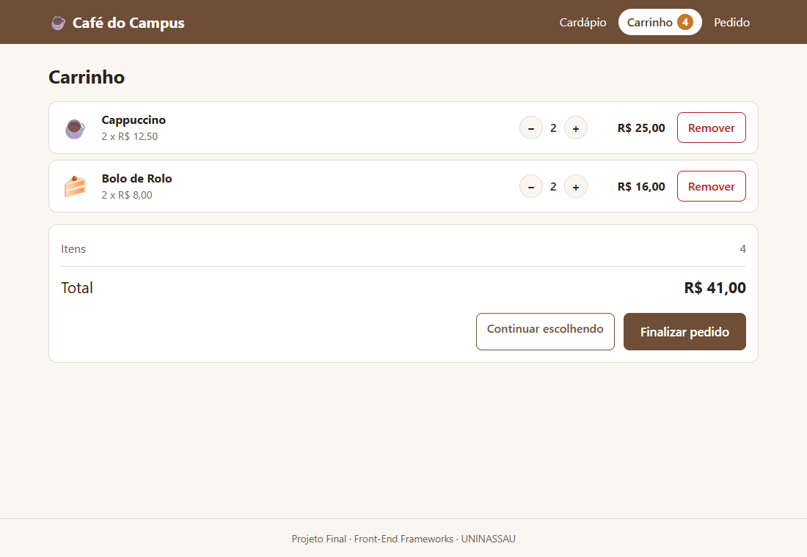
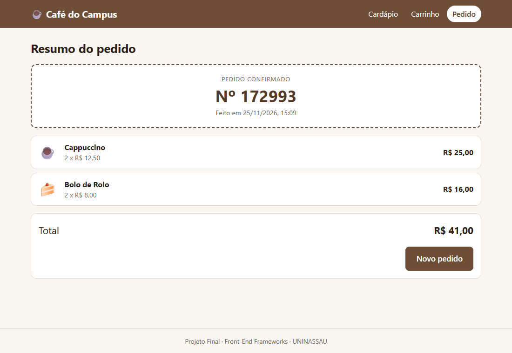

# Café do Campus · Cardápio Digital e Pedidos

Projeto Final da disciplina **Front-End Frameworks** (UNINASSAU · ADS · 2º período · 2026.2).
Prof. Flávio José Ferreira Júnior.

## Tema escolhido

**Cafeteria.** O cardápio tem 12 itens em 3 categorias: **cafés**, **bolos** e **salgados**.

O cliente escolhe os itens no cardápio, monta o carrinho e finaliza o pedido, recebendo um
resumo com o número do pedido. Tudo roda localmente: não há servidor, banco de dados, login
nem pagamento.

## Como rodar

Pré-requisito: [Node.js](https://nodejs.org) 20.19+ ou 22.12+ (exigência do Vite 8; testado com o Node 24).
Confira a versão com `node -v`.

No terminal do VS Code, dentro da pasta do projeto:

```bash
npm install
npm run dev
```

Depois abra o endereço que aparece no terminal (normalmente <http://localhost:5173>).

## Telas

| Tela | Rota | O que mostra |
| --- | --- | --- |
| Cardápio | `/` | Lista de itens, filtro por categoria, busca por nome e botão "Adicionar". |
| Carrinho | `/carrinho` | Itens escolhidos, quantidade (+ / −), botão de remover, total e botão "Finalizar pedido". |
| Resumo do pedido | `/pedido` | Número do pedido, itens, total e botão "Novo pedido". |
| Página 404 | qualquer outra | Aviso de página não encontrada, com link de volta para o cardápio. |

| Cardápio | Carrinho | Resumo do pedido |
| --- | --- | --- |
|  |  |  |

## Estrutura de pastas

```text
.
├── public/
│   └── cardapio.json          cardápio carregado com fetch (extra)
├── src/
│   ├── components/            componentes reutilizáveis, configurados por props
│   │   ├── Header.jsx
│   │   ├── FiltroCategorias.jsx
│   │   ├── CampoBusca.jsx
│   │   ├── ListaProdutos.jsx
│   │   ├── CardProduto.jsx
│   │   ├── ItemCarrinho.jsx
│   │   └── Mensagem.jsx
│   ├── pages/                 uma página por rota
│   │   ├── Cardapio.jsx
│   │   ├── Carrinho.jsx
│   │   ├── Pedido.jsx
│   │   └── NaoEncontrada.jsx
│   ├── dados/
│   │   └── cardapio.js        array de objetos do cardápio + categorias
│   ├── context/               carrinho compartilhado (Context API)
│   │   ├── CarrinhoContext.js
│   │   └── CarrinhoProvider.jsx
│   ├── utils/
│   │   └── formatar.js        formatação de preço e de texto da busca
│   ├── App.jsx                Header + rotas
│   ├── main.jsx               ponto de entrada (BrowserRouter + CarrinhoProvider)
│   └── index.css              estilos
├── index.html
├── package.json
└── README.md
```

## Requisitos obrigatórios — onde cada um está no código

| # | Requisito | Onde ver |
| --- | --- | --- |
| 1 | Projeto React criado com Vite, com pastas `components`, `pages` e `dados` | `package.json`, `vite.config.js` e a pasta `src/` |
| 2 | Pelo menos 4 componentes reutilizáveis com props | 7 componentes em `src/components/`. O `ItemCarrinho` é usado no Carrinho e no Resumo, mudando só as props |
| 3 | Cardápio como array de objetos, `map` com `key`, `filter` e `reduce` | Array em `src/dados/cardapio.js`; `map` em `ListaProdutos.jsx`; `filter` em `pages/Cardapio.jsx`; `reduce` em `context/CarrinhoProvider.jsx` |
| 4 | `useState` para o filtro de categoria e para o carrinho | Filtro em `pages/Cardapio.jsx`; carrinho em `context/CarrinhoProvider.jsx` |
| 5 | Carrinho compartilhado entre as telas | Context API: `CarrinhoProvider` em volta do `<App />` (`main.jsx`) e hook `useCarrinho()` nas páginas |
| 6 | React Router com 3 rotas | `src/App.jsx` (`/`, `/carrinho`, `/pedido`) |
| 7 | Fluxo completo: adicionar, remover, total, finalizar e resumo com número | `adicionarItem`, `removerItem`, `total` e `finalizarPedido` em `CarrinhoProvider.jsx`; telas em `src/pages/` |
| 8 | Roda com `npm install` e `npm run dev`; README explica | Seção "Como rodar" acima |

## Requisitos extras (bônus)

| Extra | Onde ver |
| --- | --- |
| Cardápio carregado de um JSON com `fetch`, com mensagens de carregando e de erro | `useEffect` em `pages/Cardapio.jsx`, lendo `public/cardapio.json`. Se o `fetch` falhar, a tela mostra a mensagem de erro e usa a cópia local de `src/dados/cardapio.js` |
| Carrinho salvo no `localStorage` | `CarrinhoProvider.jsx` (lê ao iniciar e salva a cada mudança) |
| Campo de busca por nome | `components/CampoBusca.jsx` + segundo `filter` em `pages/Cardapio.jsx` (ignora acentos e maiúsculas) |
| Alterar a quantidade de cada item | Botões + e − em `components/ItemCarrinho.jsx` e função `alterarQuantidade` |
| Página 404 | `pages/NaoEncontrada.jsx` e a rota `path="*"` em `App.jsx` |

> O cardápio existe em dois arquivos com o mesmo conteúdo: `public/cardapio.json` (lido com
> `fetch`) e `src/dados/cardapio.js` (array de objetos pedido no requisito 3, usado como cópia
> local). Ao mudar um item, altere os dois.

## Equipe e papéis

<!-- PREENCHER com os nomes dos integrantes antes de entregar. -->

| Integrante | Matrícula | Papel |
| --- | --- | --- |
| Lucas Victor Silva | 01905921 | Interface e componentes, Estado e dados, Rotas e Dock |

## Gerar o .zip da entrega (sem `node_modules`)

Com tudo commitado, na pasta do projeto:

```bash
git archive --format=zip --output=../cardapio-digital-cafeteria.zip HEAD
```

O `git archive` só inclui os arquivos versionados, então `node_modules` fica de fora
automaticamente (ela está no `.gitignore`).
